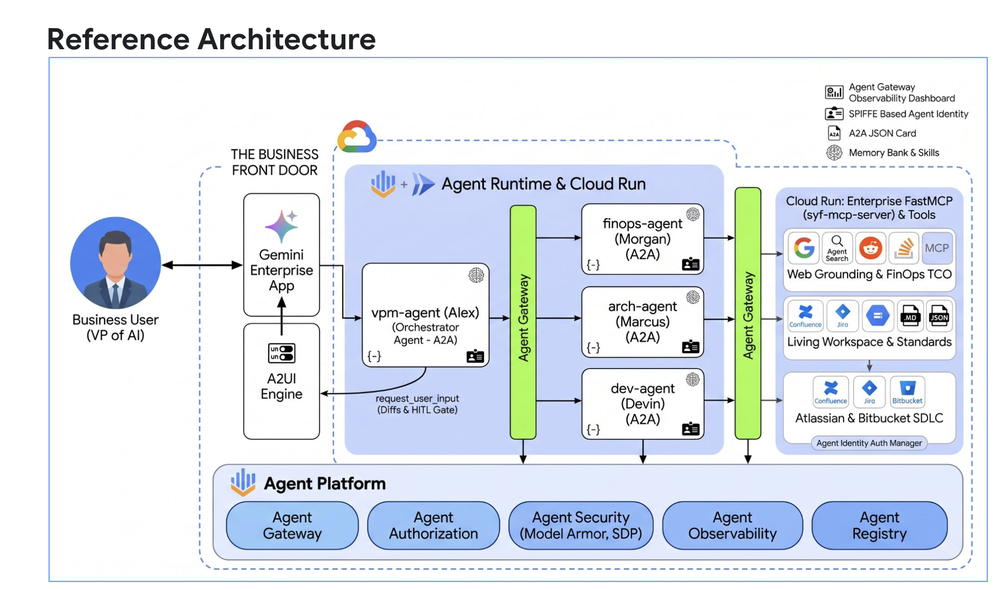

# Synchrony Financial (SYF) Virtual Product Manager — A2A & Governance Handoff Manifest

> **Purpose**: This manifest provides all live endpoints, A2A Agent Card URLs, Vertex AI Agent Runtime resource URIs, SPIFFE Principal Identities, Cloud Run Service Account Identities, and Agent Identity Auth Manager configurations deployed in **`vertexai-l300-capstone` (`121190797389`)**. Use this manifest to register the agents in **Google Cloud Agent Registry**, bind them to **Agent Gateway**, and attach **Model Armor** floorplates in the governance project.



---

## 1. Environment & Project Metadata

| Parameter | Value |
| :--- | :--- |
| **GCP Project ID** | `vertexai-l300-capstone` |
| **GCP Project Number** | `121190797389` |
| **GCP Organization ID** | `526625392936` |
| **Primary Region** | `us-central1` |
| **Gemini 3.x Model Endpoint Location** | `global` (`gemini-3.8-flash` & `gemini-3.5-flash-lite`) |
| **Living Product Workspace Bucket** | `gs://vertexai-l300-capstone-syf-vpm-workspace` |
| **Agent Identity Auth Provider URI** | `projects/vertexai-l300-capstone/locations/us-central1/authProviders/syf-mcp-auth-provider` |
| **Gemini Enterprise App ID** | `projects/121190797389/locations/global/collections/default_collection/engines/gemini-enterprise-17606215_1760621535927` |
| **Registered Gemini Enterprise Agent (Alex — A2UI + A2A)** | `projects/121190797389/locations/global/collections/default_collection/engines/gemini-enterprise-17606215_1760621535927/assistants/default_assistant/agents/6339380200979178676` |
| **Registered Gemini Enterprise Agent (Morgan — FinOps)** | `projects/121190797389/locations/global/collections/default_collection/engines/gemini-enterprise-17606215_1760621535927/assistants/default_assistant/agents/2339823983934157059` |
| **Registered Gemini Enterprise Agent (Marcus — CISO)** | `projects/121190797389/locations/global/collections/default_collection/engines/gemini-enterprise-17606215_1760621535927/assistants/default_assistant/agents/6339380200979178865` |
| **Registered Gemini Enterprise Agent (Devin — Cloud/IaC)** | `projects/121190797389/locations/global/collections/default_collection/engines/gemini-enterprise-17606215_1760621535927/assistants/default_assistant/agents/10474427205848767651` |

---

## 2. Deployed Agent Fleet & A2A Agent Card URLs

### 2.1 Vertex AI Agent Runtime Agents (SPIFFE Principal Identity)

#### 1. **Alex — Root Virtual Product Manager (`vpm-agent-a2ui`)**
- **Role**: Executive Product Orchestrator (ADK 2.0 Graph Workflow + A2UI v0.9 3-Card Interactive Canvas + Multi-File Workspace + Antigravity Skills + HITL Gatekeeper)
- **Model & Thinking Config**: `gemini-3.8-flash` (`thinking_level="MEDIUM"`, `temperature=0.1`)
- **Agent Runtime Resource ID**:
  ```text
  projects/121190797389/locations/us-central1/reasoningEngines/4697195312597434368
  ```
- **A2A + A2UI v0.9 JSON-RPC Invocation Endpoint**:
  ```text
  https://us-central1-aiplatform.googleapis.com/reasoningEngines/v1/projects/121190797389/locations/us-central1/reasoningEngines/4697195312597434368/api/a2a/app
  ```
- **A2A Agent Card URL**:
  ```text
  https://us-central1-aiplatform.googleapis.com/reasoningEngines/v1/projects/121190797389/locations/us-central1/reasoningEngines/4697195312597434368/api/a2a/app/.well-known/agent-card.json
  ```
- **Base `/api` Passthrough URL (`APP_URL`)**:
  ```text
  https://us-central1-aiplatform.googleapis.com/reasoningEngines/v1/projects/121190797389/locations/us-central1/reasoningEngines/4697195312597434368/api
  ```
- **SPIFFE Principal Identity**:
  ```text
  principal://agents.global.org-526625392936.system.id.goog/resources/aiplatform/projects/121190797389/locations/us-central1/reasoningEngines/4697195312597434368
  ```
- **Console URL**:
  `https://console.cloud.google.com/vertex-ai/agents/agent-engines/locations/us-central1/agent-engines/4697195312597434368?project=vertexai-l300-capstone`
- **Gemini Enterprise Registered Agent Resource (`Alex (SYF Virtual Product Manager)`)**:
  ```text
  projects/121190797389/locations/global/collections/default_collection/engines/gemini-enterprise-17606215_1760621535927/assistants/default_assistant/agents/6339380200979178676
  ```
- **Agent Icon URI (SVG)**: `https://fonts.gstatic.com/s/e/notoemoji/latest/1f3af/emoji.svg` (also local SVG at `assets/icons/alex_vpm_icon.svg`)
- **Live JSON Agent Card (`agent-card.json`)**:
  ```json
  {
    "name": "vpm_agent",
    "description": "Alex (SYF Virtual Product Manager) — Synchrony Financial's AI Virtual Product Manager. Evaluates PRDs, coordinates FinOps (Morgan), CISO Architecture (Marcus), and Cloud Engineering (Devin), stress-tests architectural curveballs, and syncs approved specs to Confluence and Jira.",
    "iconUrl": "https://fonts.gstatic.com/s/e/notoemoji/latest/1f3af/emoji.svg",
    "supportedInterfaces": [
      {
        "url": "https://us-central1-aiplatform.googleapis.com/reasoningEngines/v1/projects/121190797389/locations/us-central1/reasoningEngines/4697195312597434368/api/a2a/app",
        "protocolBinding": "JSONRPC",
        "protocolVersion": "1.0"
      },
      {
        "url": "https://us-central1-aiplatform.googleapis.com/reasoningEngines/v1/projects/121190797389/locations/us-central1/reasoningEngines/4697195312597434368/api/a2a/app",
        "protocolBinding": "JSONRPC",
        "protocolVersion": "0.3"
      }
    ],
    "version": "0.1.0",
    "capabilities": {
      "streaming": true,
      "extensions": [
        {
          "uri": "https://google.github.io/adk-docs/a2a/a2a-extension/",
          "description": "Ability to use the new agent executor implementation",
          "required": false
        },
        {
          "uri": "https://a2ui.org/a2a-extension/a2ui/v0.9",
          "description": "Ability to render A2UI v0.9 3-Card Vendor & CISO Canvas surfaces",
          "params": {
            "supportedCatalogIds": [
              "https://www.gstatic.com/vertexaisearch/a2ui/v0_9/gemini_enterprise_composite_catalog.json"
            ]
          },
          "required": false
        }
      ]
    },
    "defaultInputModes": [
      "text/plain"
    ],
    "defaultOutputModes": [
      "text/plain"
    ],
    "skills": [
      {
        "id": "vpm_agent",
        "name": "workflow",
        "description": "Alex (SYF Virtual Product Manager) — Synchrony Financial's AI Virtual Product Manager. Evaluates PRDs, coordinates FinOps (Morgan), CISO Architecture (Marcus), and Cloud Engineering (Devin), stress-tests architectural curveballs, and syncs approved specs to Confluence and Jira.",
        "tags": [
          "graph_workflow"
        ]
      },
      {
        "id": "intake_router_intake_router",
        "name": "intake_router: custom",
        "description": "Classifies the incoming request and routes via ADK 2.0 conditional dictionary edges.",
        "tags": [
          "sub_agent:intake_router",
          "custom_agent"
        ]
      },
      {
        "id": "morgan_finops_node_morgan_finops_node",
        "name": "morgan_finops_node: custom",
        "description": "Parallel Branch 1A: Delegates FinOps TCO & Google Search Grounding to Morgan (`finops-agent`).",
        "tags": [
          "sub_agent:morgan_finops_node",
          "custom_agent"
        ]
      },
      {
        "id": "marcus_arch_node_marcus_arch_node",
        "name": "marcus_arch_node: custom",
        "description": "Parallel Branch 1B: Delegates Baseline v1.0 Zero-Trust & Latency Audit to Marcus (`arch-agent`).",
        "tags": [
          "sub_agent:marcus_arch_node",
          "custom_agent"
        ]
      },
      {
        "id": "dynamic_curveball_orchestrator_dynamic_curveball_orchestrator",
        "name": "dynamic_curveball_orchestrator: custom",
        "description": "ADK 2.0 Dynamic Fan-Out Orchestrator (`https://adk.dev/graphs/dynamic/`). Dynamically spawns `marcus_curveball_worker` and `confluence_patch_worker` in parallel using `ctx.run_node(..., run_id=...)` and `await asyncio.gather(...)`.",
        "tags": [
          "sub_agent:dynamic_curveball_orchestrator",
          "custom_agent"
        ]
      },
      {
        "id": "confluence_publish_node_confluence_publish_node",
        "name": "confluence_publish_node: custom",
        "description": "Parallel Branch 3A: Promotes `PRD-AI-EVAL-101.md` & `ADR-001-Eval-Gateway.md` to APPROVED on Confluence.",
        "tags": [
          "sub_agent:confluence_publish_node",
          "custom_agent"
        ]
      },
      {
        "id": "jira_epic_stories_node_jira_epic_stories_node",
        "name": "jira_epic_stories_node: custom",
        "description": "Parallel Branch 3B: Updates Epic `SYF-5` and batch-creates all 8 Sprint 1 stories (`SYF-6..SYF-13`).",
        "tags": [
          "sub_agent:jira_epic_stories_node",
          "custom_agent"
        ]
      },
      {
        "id": "memory_consolidation_node_memory_consolidation_node",
        "name": "memory_consolidation_node: custom",
        "description": "Parallel Branch 3C: Commits approved FinOps, CISO, and Sprint 1 decisions to Vertex AI Memory Bank.",
        "tags": [
          "sub_agent:memory_consolidation_node",
          "custom_agent"
        ]
      },
      {
        "id": "reject_draft_node_reject_draft_node",
        "name": "reject_draft_node: custom",
        "description": "Handles 'Reject / Keep in Draft' with zero Confluence or Jira mutations.",
        "tags": [
          "sub_agent:reject_draft_node",
          "custom_agent"
        ]
      },
      {
        "id": "open_ended_qa_node_open_ended_qa_node",
        "name": "open_ended_qa_node: custom",
        "description": "Handles open-ended technical/product questions and blocker reports naturally without rigid templates.",
        "tags": [
          "sub_agent:open_ended_qa_node",
          "custom_agent"
        ]
      },
      {
        "id": "synthesizer_synthesizer",
        "name": "synthesizer: custom",
        "description": "Terminal synthesis node at the end of the ADK 2.0 Workflow graph. Emits strictly one `TaskArtifactUpdateEvent` per turn and attaches the A2UI v0.9 `DataPart`s cleanly.",
        "tags": [
          "sub_agent:synthesizer",
          "custom_agent"
        ]
      }
    ],
    "preferredTransport": "JSONRPC",
    "protocolVersion": "0.3",
    "url": "https://us-central1-aiplatform.googleapis.com/reasoningEngines/v1/projects/121190797389/locations/us-central1/reasoningEngines/4697195312597434368/api/a2a/app"
  }
  ```

#### 2. **Morgan — Deep Research & FinOps Analyst (`finops-agent`)**
- **Role**: Vendor Evaluation Matrix, 3-Year TCO Modeling ($2M Build vs. $500k Buy), Token Sensitivity & Routing Roi
- **Model & Thinking Config**: `gemini-3.5-flash-lite` (`thinking_level="LOW"`, `temperature=0.0`)
- **Agent Runtime Resource ID**:
  ```text
  projects/121190797389/locations/us-central1/reasoningEngines/1052078971031650304
  ```
- **A2A Agent Card URL**:
  ```text
  https://us-central1-aiplatform.googleapis.com/reasoningEngines/v1/projects/121190797389/locations/us-central1/reasoningEngines/1052078971031650304/api/a2a/app/.well-known/agent-card.json
  ```
- **SPIFFE Principal Identity**:
  ```text
  principal://agents.global.org-526625392936.system.id.goog/resources/aiplatform/projects/121190797389/locations/us-central1/reasoningEngines/1052078971031650304
  ```
- **Console URL**:
  `https://console.cloud.google.com/vertex-ai/agents/agent-engines/locations/us-central1/agent-engines/1052078971031650304?project=vertexai-l300-capstone`
- **Agent Icon URI (SVG)**: `https://fonts.gstatic.com/s/e/notoemoji/latest/1f4ca/emoji.svg` (also local SVG at `assets/icons/morgan_finops_icon.svg`)

---

### 2.2 Google Cloud Run Specialist Agents (Service Account Identity + A2A JSON-RPC)

#### 3. **Marcus — Enterprise Architecture & Zero-Trust Compliance Specialist (`syf-arch-agent`)**
- **Role**: PCI-DSS v4.0, CareCredit HIPAA, FFIEC Auditability, AWS OpenShift (ROSA) ↔ GCP Interconnect & Dual-DLP Gateway Validation
- **Model & Thinking Config**: `gemini-3.5-flash-lite` (`thinking_level="LOW"`, `temperature=0.0`)
- **Cloud Run Service URL**:
  ```text
  https://syf-arch-agent-121190797389.us-central1.run.app
  ```
- **A2A Agent Card URL**:
  ```text
  https://syf-arch-agent-121190797389.us-central1.run.app/a2a/app/.well-known/agent-card.json
  ```
- **A2A JSON-RPC Invocation Endpoint**:
  ```text
  https://syf-arch-agent-121190797389.us-central1.run.app/a2a/app
  ```
- **Runtime Service Account**:
  `syf-arch-agent-sa@vertexai-l300-capstone.iam.gserviceaccount.com`
- **Agent Icon URI (SVG)**: `https://fonts.gstatic.com/s/e/notoemoji/latest/1f6e1/emoji.svg` (also local SVG at `assets/icons/marcus_ciso_icon.svg`)

#### 4. **Devin — Lead Platform Developer & SDLC Scaffolder (`syf-dev-agent`)**
- **Role**: OpenShift UBI9 (`UID 1001`) FastAPI OTel + Cloud DLP Interceptor Scaffolder, Bitbucket Branch/PR Generator, Bidirectional Blocker Sync
- **Model & Thinking Config**: `gemini-3.5-flash-lite` (`thinking_level="LOW"`, `temperature=0.0`)
- **Cloud Run Service URL**:
  ```text
  https://syf-dev-agent-121190797389.us-central1.run.app
  ```
- **A2A Agent Card URL**:
  ```text
  https://syf-dev-agent-121190797389.us-central1.run.app/a2a/app/.well-known/agent-card.json
  ```
- **A2A JSON-RPC Invocation Endpoint**:
  ```text
  https://syf-dev-agent-121190797389.us-central1.run.app/a2a/app
  ```
- **Runtime Service Account**:
  `syf-dev-agent-sa@vertexai-l300-capstone.iam.gserviceaccount.com`
- **Agent Icon URI (SVG)**: `https://fonts.gstatic.com/s/e/notoemoji/latest/1f4bb/emoji.svg` (also local SVG at `assets/icons/devin_dev_icon.svg`)

---

## 3. Enterprise MCP Server (`syf-mcp-server`)

| Property | Value |
| :--- | :--- |
| **Cloud Run Service Name** | `syf-mcp-server` |
| **Streamable HTTP MCP Endpoint** | `https://syf-mcp-server-121190797389.us-central1.run.app/mcp` |
| **Health Check Endpoint** | `https://syf-mcp-server-121190797389.us-central1.run.app/healthz` |
| **Auth Provider Resource** | `projects/vertexai-l300-capstone/locations/us-central1/authProviders/syf-mcp-auth-provider` |
| **Exposed Tools (12)** | `list_workspace_documents`, `get_workspace_document`, `patch_document_section`, `query_syf_architecture_catalog`, `calculate_llm_eval_tco`, `validate_pci_hipaa_guardrails`, `create_jira_epic_and_stories`, `assign_jira_ticket_to_squad`, `publish_confluence_spec`, `create_bitbucket_branch_and_pr`, `scaffold_openshift_eval_service`, `sync_sdlc_ticket_blocker` |

---

## 4. Quick Commands for Governance Project Registration (Colleague Handoff)

### 4.1 Register All 4 A2A Agents in Agent Registry / Gemini App
```bash
# 1. Register Alex (Root Virtual Product Manager — A2A + A2UI v0.9) via A2A Agent Card URL
agents-cli publish gemini \
  --registration-type a2a \
  --agent-card-url "https://us-central1-aiplatform.googleapis.com/reasoningEngines/v1/projects/121190797389/locations/us-central1/reasoningEngines/4697195312597434368/api/a2a/app/.well-known/agent-card.json" \
  --gemini-app-id "<TARGET_GEMINI_APP_ID>" \
  --display-name "Alex (SYF Virtual Product Manager)"

# 2. Register Morgan (FinOps Lead) via A2A Agent Card URL
agents-cli publish gemini \
  --registration-type a2a \
  --agent-card-url "https://us-central1-aiplatform.googleapis.com/reasoningEngines/v1/projects/121190797389/locations/us-central1/reasoningEngines/1052078971031650304/api/a2a/app/.well-known/agent-card.json" \
  --gemini-app-id "<TARGET_GEMINI_APP_ID>" \
  --display-name "Morgan (SYF FinOps Lead)"

# 3. Register Marcus (Architecture & CISO Agent) via A2A Agent Card URL
agents-cli publish gemini \
  --registration-type a2a \
  --agent-card-url "https://syf-arch-agent-121190797389.us-central1.run.app/a2a/app/.well-known/agent-card.json" \
  --gemini-app-id "<TARGET_GEMINI_APP_ID>" \
  --display-name "Marcus (SYF CISO & Enterprise Architect)"

# 4. Register Devin (Developer & SDLC Agent) via A2A Agent Card URL
agents-cli publish gemini \
  --registration-type a2a \
  --agent-card-url "https://syf-dev-agent-121190797389.us-central1.run.app/a2a/app/.well-known/agent-card.json" \
  --gemini-app-id "<TARGET_GEMINI_APP_ID>" \
  --display-name "Devin (SYF Lead Cloud & IaC Engineer)"
```

### 4.2 Cross-Project IAM Grants Required When Binding External Agent Gateway
If the governance project (`<GOV_PROJECT_NUMBER>`) invokes these agents through an external **Agent Gateway**:
```bash
# Grant Cloud Run Invoker to Governance Project's Discovery Engine / Gateway SA
for SVC in syf-arch-agent syf-dev-agent syf-mcp-server; do
  gcloud run services add-iam-policy-binding $SVC \
    --project=vertexai-l300-capstone \
    --region=us-central1 \
    --member="serviceAccount:service-<GOV_PROJECT_NUMBER>@gcp-sa-discoveryengine.iam.gserviceaccount.com" \
    --role="roles/run.invoker"
done

# Grant Vertex AI User to Governance Project SA for Agent Runtime invocation
gcloud projects add-iam-policy-binding vertexai-l300-capstone \
  --member="serviceAccount:service-<GOV_PROJECT_NUMBER>@gcp-sa-discoveryengine.iam.gserviceaccount.com" \
  --role="roles/aiplatform.user"
```
