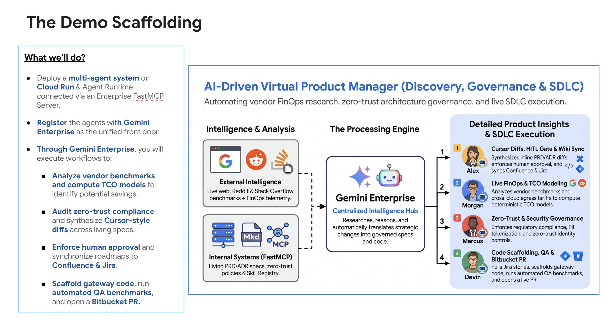
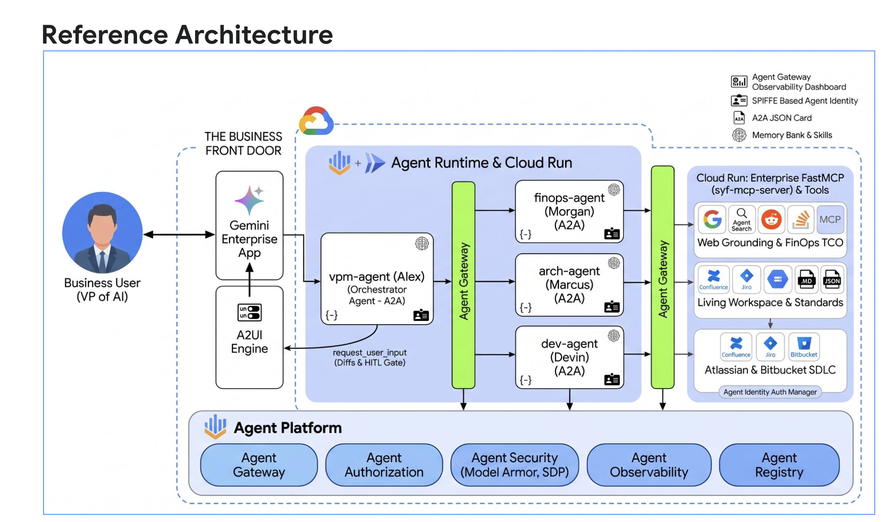

# AI-Driven Virtual Product Manager (Discovery, Governance & SDLC)

An enterprise multi-agent platform built on **Google ADK 2.0 (`Workflow` Graph Orchestration)**, **Vertex AI Agent Runtime**, **Google Cloud Run**, **A2A JSON-RPC + A2UI v0.9**, **FastMCP**, and **Gemini Enterprise**.

Modeled for **Synchrony Financial (SYF)**, this system automates cross-functional product discovery, live vendor FinOps & 3-year Total Cost of Ownership (TCO) modeling, zero-trust CISO regulatory governance, "Cursor-style" living specification diffs with Human-in-the-Loop (HITL) approval, live **Atlassian Confluence & Jira** synchronization, and autonomous 8-file **Bitbucket Cloud** code scaffolding & deployment verification.

---

## 1. Overall Demo Flow & Reference Architecture

### 1.1 Overall Demo Flow & Scaffolding


### 1.2 Enterprise Reference Architecture


---

## 2. Multi-Agent Fleet & Component Topology

| Component | Persona & Role | ADK 2.0 Architecture & Model | Runtime Target | Protocol & Zero-Trust Identity |
| :--- | :--- | :--- | :--- | :--- |
| **[`vpm-agent`](./vpm-agent)** | **Alex** — Root Virtual PM Orchestrator (Multi-File Diffs, A2UI v0.9 3-Card UI, HITL Gate, Confluence & Jira Sync) | ADK 2.0 `Workflow` Graph + `JoinNode` (`gemini-3.8-flash` / `gemini-3.5-flash-lite`) | **Vertex AI Agent Runtime** (`ReasoningEngine`) | A2A JSON-RPC + A2UI v0.9 / SPIFFE Principal + Vertex Memory Bank |
| **[`finops-agent`](./finops-agent)** | **Morgan** — Deep Research & FinOps Lead (Live Web Grounding + Deterministic 1-Yr & 3-Yr TCO Modeling) | ADK 2.0 `Workflow` Parallel Fan-Out (`gemini-3-flash-preview`, `thinking_level=low`) | **Vertex AI Agent Runtime** (`ReasoningEngine`) | A2A JSON-RPC / SPIFFE Principal + `GcpAuthProvider` |
| **[`arch-agent`](./arch-agent)** | **Marcus** — CISO & Enterprise Architect (OCC, PCI-DSS v4.0, CareCredit HIPAA & Curveball Blast-Radius) | ADK 2.0 `Workflow` Graph (`gemini-3-flash-preview`, `thinking_level=low`) | **Google Cloud Run** (`syf-arch-agent`) | Remote A2A JSON-RPC (`/.well-known/agent-card.json`) / Dedicated IAM SA |
| **[`dev-agent`](./dev-agent)** | **Devin** — Lead Cloud & IaC Engineer (7-Step Autonomous Scaffolding, 12-Test Pytest QA, Bitbucket PR & Live Deploy) | ADK 2.0 `Workflow` + `FunctionNode` (`gemini-3-flash-preview`, `thinking_level=low`) | **Vertex AI Agent Runtime** (`ReasoningEngine`) | A2A JSON-RPC / SPIFFE Principal + Auth Manager |
| **[`syf-mcp-server`](./syf-mcp-server)** | **Enterprise SDLC FastMCP Server & Live Gateway** (GCS Living Workspace, Confluence, Jira, Bitbucket, Skill Registry, Live DLP Proxy) | FastMCP Streamable HTTP (`/mcp`) + FastAPI (`/live-gateway`, `/skills-ui`) | **Google Cloud Run** (`syf-mcp-server`) | GCP Agent Identity Auth Manager (`retrieve_credentials`) |

> 📄 For the complete tool-by-tool mapping across all 4 agents and all 11 FastMCP endpoints, see **[`AGENT_TO_TOOLS.md`](./AGENT_TO_TOOLS.md)**.

---

## 3. End-to-End Capabilities (3-Turn Executive Lifecycle)

1. **Turn 1 — Parallel Discovery, FinOps TCO & Zero-Trust Audit (`@Alex` → `Morgan` + `Marcus`)**:
   - **Morgan (`finops-agent`)** combines GCS telemetry benchmarks (`eval_vendor_benchmarks.json`) with live Google Search grounding to model 1-year and 3-year TCO across **Arize AX**, **Braintrust**, and **Self-Hosted Langfuse v3** at `5M` baseline and `50M` monthly surge spans.
   - **Marcus (`arch-agent`)** audits gateway architectures against OCC Heightened Standards, PCI-DSS v4.0 (`PAN`/`SSN`), CareCredit HIPAA (`MRN`/`ICD-10`), and AWS ROSA OpenShift mTLS 1.3 rules (`architecture_standards.json`).
   - **Alex (`vpm-agent`)** synthesizes findings into interactive **A2UI v0.9** executive cards and stages redlines on `PRD-AI-EVAL-101.md` and `ADR-001-Eval-Gateway.md`.
2. **Turn 2 — Dynamic Executive Curveball & HITL Confluence/Jira Commit (`@Alex` + `Marcus`)**:
   - Handles live executive curveballs (e.g., *Kong v3.4 Q1 deprecation → Internal Envoy Service Mesh*, *OpenTelemetry Python gRPC memory leak → async HTTP/protobuf*, *CareCredit HIPAA surge*, or *unscripted developer/community issues* grounded via StackOverflow, GitHub Issues, Reddit, and Google Search).
   - Generates color-coded `[-REMOVED-]` / `[+ADDED+]` diffs on Confluence Cloud and pauses at a **Human-in-the-Loop (HITL)** approval gate (`Approve & Commit`).
   - Upon approval, promotes `PRD-AI-EVAL-101` & `ADR-001-Eval-Gateway` to `APPROVED` in **Confluence Cloud**, commits decisions to **Vertex AI Memory Bank**, and creates **8 linked Sprint 1 stories** under Master Epic **`SYF-5`** in **Jira Cloud**.
3. **Turn 3 — Autonomous 7-Step Sprint 1 Engineering & Live Deployment (`@Devin`)**:
   - Loads 6 Synchrony engineering skills (`SKILL.md`), pulls the 8 assigned Sprint 1 Jira stories (`SYF-6+`), scaffolds the 8-file production Envoy/OpenTelemetry DLP Gateway repository (including AST-verified custom curveball features), runs a 2-iteration Security/DLP & 500-Span Golden Latency self-correction loop (`12/12` Pytest passed, `13.8ms` P95 `<25ms` SLA), commits all 8 files to **Bitbucket Cloud** (`feature/SYF-5-envoy-otel-gateway`), opens a live Pull Request, transitions all 8 Jira stories to **`DONE`**, and smoke-tests `/live-gateway/api/evaluate`.

---

## 4. Step-by-Step Setup: Clone to Working Deployment

### Prerequisites
- **Google Cloud Project** with Billing enabled and Vertex AI + Gemini Enterprise access
- **CLI Tools**:
  - [`gcloud` CLI](https://cloud.google.com/sdk/docs/install) (`gcloud auth login && gcloud auth application-default login`)
  - [`uv`](https://docs.astral.sh/uv/) (`curl -LsSf https://astral.sh/uv/install.sh | sh`)
  - `google-agents-cli` (`agents-cli`) for ADK Agent Runtime deployment & Gemini Enterprise publishing
  - *(Optional)* [`terraform` >= 1.6](https://developer.hashicorp.com/terraform/install) if using Infrastructure-as-Code provisioning
- **External SaaS Sandboxes** *(for live SDLC integration)*:
  - **Atlassian Cloud** site (Confluence Space e.g. `SD` + Jira Scrum Project e.g. `SYF` with Epic `SYF-5`) and API Token
  - **Bitbucket Cloud** workspace + repository (e.g. `syf-eval-gateway` with a `main` branch) and Repository Access Token

---

### Step 1: Clone the Repository & Install Dependencies

```bash
git clone https://github.com/talktosauvik/virtual-product-manager.git
cd virtual-product-manager

# Sync isolated virtual environments for the MCP server and all 4 agents
for dir in syf-mcp-server arch-agent finops-agent vpm-agent dev-agent; do
  echo "=== Syncing $dir ==="
  (cd "$dir" && uv sync)
done
```

---

### Step 2: Configure Environment Variables (`.env`)

Copy `.env.example` to `.env` at the repository root and inside each service folder (`syf-mcp-server`, `arch-agent`, `finops-agent`, `vpm-agent`, `dev-agent`):

```bash
cp .env.example .env
for dir in syf-mcp-server arch-agent finops-agent vpm-agent dev-agent; do
  cp "$dir/.env.example" "$dir/.env"
done
```

Edit `.env` (and service `.env` files) with your Google Cloud & SDLC identifiers (**never put raw API tokens in Git** — tokens live in GCP Agent Identity Auth Manager):

```bash
GOOGLE_CLOUD_PROJECT=your-gcp-project-id
GOOGLE_CLOUD_PROJECT_NUMBER=123456789012
GOOGLE_CLOUD_LOCATION=global
GOOGLE_CLOUD_REGION=us-central1
SYF_WORKSPACE_BUCKET=your-gcp-project-id-syf-vpm-workspace

ATLASSIAN_DOMAIN=your-domain.atlassian.net
ATLASSIAN_EMAIL=you@example.com
CONFLUENCE_SPACE_KEY=SD
JIRA_PROJECT_KEY=SYF
JIRA_EPIC_KEY=SYF-5
BITBUCKET_WORKSPACE=your-bitbucket-workspace
BITBUCKET_REPO_SLUG=syf-eval-gateway
```

---

### Step 3: Provision Google Cloud Infrastructure & Seed GCS Workspace

You can provision the Google Cloud foundation using **either Terraform (`terraform/`)** or the **automated CLI bootstrap script (`scripts/setup_gcp_and_auth_manager.sh`)**:

#### Option A: Provision via Terraform (`terraform/`) — Recommended for IaC
Provisions all 11 GCP APIs, least-privilege IAM Service Accounts (`syf-mcp-server-sa`, `syf-agent-runtime-sa`), Artifact Registry, Secret Manager containers, and the versioned GCS Workspace Bucket automatically seeded with `seed_data/*.json`, `workspace_artifacts/*`, and `shared_skills/**`:

```bash
cd terraform
cp terraform.tfvars.example terraform.tfvars
# Edit terraform.tfvars with your project_id and SDLC settings
terraform init
terraform apply
cd ..
```
*(See [`terraform/README.md`](./terraform/README.md) for full variable/output details and optional Cloud Run v2 management.)*

#### Option B: Provision via CLI Bootstrap Script (`scripts/setup_gcp_and_auth_manager.sh`)
Enables required APIs, creates & seeds `gs://${SYF_WORKSPACE_BUCKET}`, and creates the Agent Identity Auth Manager provider:

```bash
export SYF_MCP_API_KEY="$(openssl rand -hex 32)"
./scripts/setup_gcp_and_auth_manager.sh
```

#### Register Atlassian & Bitbucket Credentials in GCP Agent Identity Auth Manager
Store your Atlassian API Token (`base64("email:api_token")`) and Bitbucket Repository Access Token in GCP Agent Identity Auth Manager so `syf-mcp-server` and agents resolve credentials dynamically at runtime via `AuthProviderCredentialsServiceClient`:

```bash
# 1. Atlassian Cloud Auth Provider (Basic base64 token of email:api_token)
ATLASSIAN_B64="$(printf '%s:%s' "$ATLASSIAN_EMAIL" "$YOUR_ATLASSIAN_API_TOKEN" | base64 -w0)"
gcloud alpha agent-identity auth-providers create atlassian-cloud-auth-provider \
  --project="$GOOGLE_CLOUD_PROJECT" \
  --location="$GOOGLE_CLOUD_REGION" \
  --api-key="$ATLASSIAN_B64" \
  --description="Atlassian Jira & Confluence Auth Provider"

# 2. Bitbucket Cloud Auth Provider (Repository Access Token)
gcloud alpha agent-identity auth-providers create bitbucket-cloud-auth-provider \
  --project="$GOOGLE_CLOUD_PROJECT" \
  --location="$GOOGLE_CLOUD_REGION" \
  --api-key="$YOUR_BITBUCKET_ACCESS_TOKEN" \
  --description="Bitbucket Cloud v2.0 Auth Provider"
```

---

### Step 4: Deploy `syf-mcp-server` & Seed Confluence / Jira Baseline

1. **Deploy `syf-mcp-server` to Google Cloud Run**:
   ```bash
   gcloud run deploy syf-mcp-server \
     --source syf-mcp-server \
     --project "$GOOGLE_CLOUD_PROJECT" \
     --region "$GOOGLE_CLOUD_REGION" \
     --allow-unauthenticated
   ```
   Copy the resulting Cloud Run URL (e.g. `https://syf-mcp-server-<PROJECT_NUMBER>.us-central1.run.app`) into your `.env` files as:
   - `SYF_PUBLIC_BASE_URL=https://syf-mcp-server-...run.app`
   - `SYF_MCP_URL=https://syf-mcp-server-...run.app/mcp`
   - `SYF_MCP_SERVER_URL=https://syf-mcp-server-...run.app/mcp`
   - `LIVE_GATEWAY_URL=https://syf-mcp-server-...run.app/live-gateway`

2. **Seed Initial `v1.0 DRAFT` Confluence Pages & Jira Master Epic**:
   ```bash
   uv run --directory syf-mcp-server python ../scripts/seed_live_sdlc.py
   ```

---

### Step 5: Deploy the 4 AI Agents

#### 5.1 Deploy `arch-agent` — Marcus (Google Cloud Run Remote A2A Server)
```bash
cd arch-agent
uv run agents-cli deploy \
  --project "$GOOGLE_CLOUD_PROJECT" \
  --region "$GOOGLE_CLOUD_REGION"
cd ..
```
Set `ARCH_AGENT_URL` in `vpm-agent/.env` to the deployed Cloud Run URL (verify `curl $ARCH_AGENT_URL/.well-known/agent-card.json`).

#### 5.2 Deploy `finops-agent` — Morgan (Vertex AI Agent Runtime)
```bash
cd finops-agent
uv run agents-cli deploy \
  --target agent-engine \
  --project "$GOOGLE_CLOUD_PROJECT" \
  --region "$GOOGLE_CLOUD_REGION"
cd ..
```
Copy the `remote_agent_runtime_id` from `finops-agent/deployment_metadata.json` into `vpm-agent/.env` as `FINOPS_AGENT_ENGINE_ID`.

#### 5.3 Deploy `dev-agent` — Devin (Vertex AI Agent Runtime)
```bash
cd dev-agent
uv run agents-cli deploy \
  --target agent-engine \
  --project "$GOOGLE_CLOUD_PROJECT" \
  --region "$GOOGLE_CLOUD_REGION"
cd ..
```

#### 5.4 Deploy `vpm-agent` — Alex (Vertex AI Agent Runtime)
```bash
cd vpm-agent
uv run agents-cli deploy \
  --target agent-engine \
  --project "$GOOGLE_CLOUD_PROJECT" \
  --region "$GOOGLE_CLOUD_REGION"
cd ..
```

---

### Step 6: Publish Agents to Gemini Enterprise

Register **Alex (`vpm-agent`)** and **Devin (`dev-agent`)** into your Gemini Enterprise portal (`<YOUR_GEMINI_ENTERPRISE_APP_ID>`):

```bash
# Publish Alex (Root Virtual PM Orchestrator)
cd vpm-agent
VPM_ENGINE_ID="$(jq -r .remote_agent_runtime_id deployment_metadata.json)"
uv run agents-cli publish gemini \
  --project-id "$GOOGLE_CLOUD_PROJECT" \
  --app-id "$GEMINI_ENTERPRISE_APP_ID" \
  --location global \
  --agent-engine-id "$VPM_ENGINE_ID" \
  --display-name "Alex - Synchrony Virtual PM" \
  --description "Root Virtual Product Manager Orchestrator (Discovery, FinOps, CISO & SDLC)"
cd ..

# Publish Devin (Lead Cloud & IaC Engineer)
cd dev-agent
DEV_ENGINE_ID="$(jq -r .remote_agent_runtime_id deployment_metadata.json)"
uv run agents-cli publish gemini \
  --project-id "$GOOGLE_CLOUD_PROJECT" \
  --app-id "$GEMINI_ENTERPRISE_APP_ID" \
  --location global \
  --agent-engine-id "$DEV_ENGINE_ID" \
  --display-name "Devin - Synchrony Lead Platform Developer" \
  --description "Autonomous Lead Platform Developer & SDLC Code Scaffolder"
cd ..
```

---

## 5. Running Tests, Live Demo & Clean-Slate Reset

### Run Automated Unit & Workflow Tests Locally
```bash
uv run --directory vpm-agent pytest tests/unit -v
uv run --directory dev-agent pytest tests/unit/test_dev_agent_workflow.py -v
```

### Clean-Slate Demo Reset (1-Command Wipe Between Runs)
Resets `PRD-AI-EVAL-101.md` and `ADR-001-Eval-Gateway.md` on Confluence & GCS back to `v1.0 DRAFT`, deletes rehearsal Sprint 1 Jira tickets (`SYF-6+`) while preserving Master Epic `SYF-5`, clears `scaffolded_code/*` in GCS, and declines open Bitbucket Pull Requests while keeping `feature/SYF-5-envoy-otel-gateway` warm:

```bash
uv run --directory syf-mcp-server python reset_demo_state.py
```

---

## 6. Repository Structure

```text
virtual-product-manager/
├── assets/                                  # Demo Flow & Reference Architecture Diagrams + Agent Icons
│   ├── demo-scaffolding-flow.png            # Overall Demo Scaffolding & Multi-Agent Flow
│   └── reference-architecture.png           # Enterprise Reference Architecture Diagram
├── terraform/                               # Declarative GCP Infrastructure-as-Code (APIs, IAM, AR, GCS, Cloud Run)
├── vpm-agent/                               # Alex — Root Virtual PM Orchestrator (ADK 2.0 + A2UI v0.9)
├── finops-agent/                            # Morgan — Deep Research & FinOps TCO Sub-Agent (ADK 2.0)
├── arch-agent/                              # Marcus — CISO & Enterprise Architecture A2A Agent (ADK 2.0)
├── dev-agent/                               # Devin — 7-Step Autonomous Developer Agent (ADK 2.0)
├── syf-mcp-server/                          # Enterprise SDLC FastMCP Server & Live Gateway Runtime
├── shared_skills/                           # 6 Synchrony Engineering & Product Governance Skills (SKILL.md)
├── scripts/                                 # CLI Bootstrap, SDLC Seeding, and Clean-Slate Reset Scripts
├── AGENT_TO_TOOLS.md                        # Complete Agent-to-Tools & FastMCP Integration Matrix
├── A2A_HANDOFF_MANIFEST.md                  # A2A JSON-RPC Contracts & Cross-Agent Payload Schemas
└── SYF_VPM_Demo_Storyline_and_Runbook.md    # Live Presenter Storyline, Curveballs & Talk Track
```
