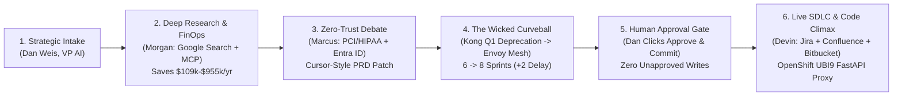

# Synchrony Financial (SYF) — Virtual Product Manager (VPM) Executive Demo Storyline & Step-by-Step Runbook

> **Aligned 1:1 with SSD Section 2.1 (Personas) & Section 2.2 ("FinOps Evaluation, The Wicked Curveball, and Code Generation") + FSR Field Notes ("Mimic Cursor", "Pull in Antigravity", "Integrate with their SDLC") + Lab 3 (`APEX013`) Agent Identity Auth Manager**

---

## 1. One-Slide Executive Storyline (Ready to Paste on a Single Slide)

### **Slide Title: Autonomous Product-to-Code Factory at Synchrony Financial**
**Subtitle**: *How "Alex" (Virtual PM on Google Antigravity & Vertex AI) Compresses 6 Weeks of Vendor FinOps, Security Architecture, and SDLC Handoff into 6 Minutes*

- **The Business Problem (Why Now)**:
  Synchrony’s AI evaluation and observability tooling across retail credit, CareCredit (HIPAA), and 9,000+ GECX contact center agents is fragmented. Traditional product discovery, vendor TCO modeling, CISO architecture review, and Jira/OpenShift scaffolding take **4–6 weeks** of manual handoffs and expensive external consultancies.
- **The Multi-Agent Solution ("Mimic Cursor" + "Pull in Antigravity" + "Integrate with SDLC")**:
  - **Alex (Virtual PM — `gemini-3.8-flash`, `thinking=MEDIUM`)**: Maintains living product files (`PRD-AI-EVAL-101.md`, `ADR-001-Eval-Gateway.md`, `BACKLOG-AI-EVAL-101.json`) in GCS with **Cursor-style surgical section diffs (`-` / `+`)** and **6 Synchrony Antigravity Skills**.
  - **Morgan (Deep Research & FinOps — `gemini-3.5-flash-lite`)**: Combines live **Google Search Grounding + Vertex AI Search** with internal FastMCP FinOps telemetry to benchmark **Arize AX ($185k/yr)**, **Braintrust ($135k/yr)**, and **Langfuse Self-Hosted ($76k/yr)** — identifying **$109,000/yr savings at 5M spans/mo** (**$955,000/yr savings at 50M GECX scale**).
  - **Marcus (Enterprise Architect — `gemini-3.5-flash-lite`)**: Enforces CISO PCI-DSS v4.0 & CareCredit HIPAA zero-egress rules, Entra ID local JWKS caching (`<2ms`), and absorbs Dan’s mid-meeting **"Wicked Curveball"** (*Q1 Kong Gateway deprecation in favor of internal Envoy Service Mesh*), deterministically recalculating the roadmap (**6 sprints → 8 sprints, +2 sprint delay**) without hallucination.
  - **Devin (Developer & SDLC Agent — `gemini-3.5-flash-lite`)**: Behind a strict **Human-in-the-Loop (HITL) Gate**, commits Jira Epic `AI-EVAL-101` & Gherkin stories, publishes the Confluence PRD, and scaffolds a hardened **Red Hat OpenShift (ROSA) UBI9 (`UID 1001`) FastAPI + OpenTelemetry + Inline DLP Proxy** in Bitbucket.

---

## 2. Personas Reference Table (SSD Section 2.1)

| Persona | Name / Identifier | Runtime & Identity (Lab 3 `APEX013`) | Model & Thinking | Operational Role in Demo |
| :--- | :--- | :--- | :--- | :--- |
| **Executive Sponsor** | **Dan Weis** | Human Evaluator (`user_id="dan_weis_ai_innovation"`) | Human-in-the-Loop | VP of AI Innovation at SYF. Challenges agents with FinOps TCO, security rules, and sudden curveballs; controls the HITL approval gate. |
| **Virtual Product Manager (VPM)** ⭐ | **Alex** (`vpm-agent`) | **Vertex AI Agent Runtime** (`8155381483301765120` — SPIFFE Principal) | `gemini-3.8-flash` (`MEDIUM`) | Root orchestrator. Loads Antigravity skills, coordinates Morgan/Marcus/Devin, applies Cursor-style unified diffs to `PRD-AI-EVAL-101.md`, enforces HITL gate. |
| **Deep Research & FinOps Analyst** | **Morgan** (`finops-agent`) | **Vertex AI Agent Runtime** (`1052078971031650304` — SPIFFE Principal) | `gemini-3.5-flash-lite` (`LOW`) | Combines **Google Search Grounding (`google_search`) + Vertex AI Search** with internal FastMCP FinOps DB (`query_vendor_cost_benchmarks`) to compare Arize, Braintrust, and Langfuse. |
| **Enterprise Architecture Specialist** | **Marcus** (`syf-arch-agent`) | **Google Cloud Run** (`syf-arch-agent-sa` — A2A JSON-RPC) | `gemini-3.5-flash-lite` (`LOW`) | Enforces zero-trust Entra ID JWKS auth, PCI-DSS v4.0 / CareCredit HIPAA zero-egress, and resolves the Q1 Kong Gateway deprecation curveball. |
| **Developer / Scaffolding Agent** | **Devin** (`syf-dev-agent`) | **Google Cloud Run** (`syf-dev-agent-sa` — A2A JSON-RPC) | `gemini-3.5-flash-lite` (`LOW`) | Takes approved PRD & Jira stories and generates runnable Red Hat OpenShift (ROSA) UBI9 `Dockerfile`, `proxy_gateway.py`, and `k8s_deployment.yaml`. |

---

## 3. Step-by-Step Demo Scenarios Table (Aligned with SSD Section 2.2 `S1`–`S8` + FSR Notes)

Use these **exact 4 conversational turns** in the Gemini Enterprise Web UI (or `agents-cli run`) to walk through the complete 8-step SSD Section 2.2 storyline (`S1` through `S8`):

| SSD 2.2 Step | Initiator | Exact Prompt to Copy-Paste (or System Action) | Underlying Multi-Agent & Platform Execution | Expected Output & Live Clickable Artifacts |
| :--- | :--- | :--- | :--- | :--- |
| **S1: Strategic Intake** + **S2: Deep Research & FinOps Decomposition** + **S3: Multi-Agent Architectural Debate** | **Dan Weis** *(Turn 1)* | **`Alex, our AI evaluation tooling is fragmented. Perform a comparative FinOps analysis of Arize, Braintrust, and Langfuse against our stack using live Google Search grounding and our internal FinOps benchmarks. Have Marcus review the data residency rules, and show me our living PRD executive summary and ADR trade-off scorecard.`** | 1. **Alex (`vpm-agent`)** loads `syf-eval-vendor-matrix` skill & delegates to **Morgan (`finops-agent`)**. 2. **Morgan** runs **live Google Search Grounding (`google_search`) + Vertex AI Search** over vendor docs AND calls `query_vendor_cost_benchmarks` via FastMCP. 3. **Marcus (`syf-arch-agent`)** calls `get_architecture_standards` and challenges SaaS egress: requires self-hosted OpenShift in private VPC with Entra ID mTLS. 4. **Alex** reads `PRD-AI-EVAL-101.md` & `ADR-001-Eval-Gateway.md` from GCS. | - **Deep Research Dossier**: Live web citations on Arize AX, Braintrust, and Langfuse v3 (OpenTelemetry + ClickHouse). - **Comparative FinOps Matrix (5M Spans/Mo)**:   • **Arize AX**: `$185,000/yr` (`38ms` P95)   • **Braintrust**: `$135,000/yr` (`22ms` P95 — fails VPC air-gap)   • **Langfuse Self-Hosted**: **`$76,000/yr`** (`14ms` P95 — **saves `$109,000/yr`**; and saves **`$955,000/yr`** at 50M GECX scale). - **Consensus ADR Scorecard**: Recommends containerized self-hosted Langfuse on ROSA OpenShift. |
| **S4: The "Wicked Curveball"** + **Cursor-Style Inline PRD Patch** + **S5: The Human Approval Gate (HITL)** | **Dan Weis** *(Turn 2)* | **`Stop. Architecture just informed me we are deprecating Kong Gateway in Q1 and moving all API traffic to an unannounced internal service mesh. How does that impact our timeline and budget? Patch Section 4 of PRD-AI-EVAL-101.md inline with a Cursor-style unified diff, and show me the revised backlog for approval before writing to Jira.`** | 1. **Alex** catches the `CB-1` pivot (`Kong Enterprise Gateway v3.4` deprecation) and delegates blast-radius analysis to **Marcus (`syf-arch-agent`)**. 2. **Marcus** decouples Kong ingress plugins, routes east-west OTel traffic to **Synchrony Internal Service Mesh** (`mesh.syf.bank/injected: "true"`, Envoy mTLS 1.3), and recalculates velocity (**6 sprints → 8 sprints, +2 sprint delay**, `+$32,000` migration). 3. **Alex** calls `patch_document_section` on `PRD-AI-EVAL-101.md` in GCS and **halts at the HITL Approval Gate (`S5`)**. | - **Curveball Impact Card**: Shows **6 sprints → 8 sprints (+2 sprint delay)**, adds `AI-STORY-104` (Envoy sidecar injection), zero hallucination. - **Cursor-Style Unified Diff (`-` / `+`)**: Shows exact lines patched in `## 4. Security, Ingress & Compliance Boundaries` of `PRD-AI-EVAL-101.md` (version bumped). - **Interactive Backlog Approval Gate (`S5`)**: Lists Epic `AI-EVAL-101` + 4 Gherkin stories and pauses: *"Dan, review the revised 8-sprint service-mesh architecture and backlog. Reply 'Approve & Commit' to write to Jira, Confluence, and Bitbucket."* |
| **S6: Backlog Generation & Wiki Publishing** + **S7: Dev Agent Scaffolding (The Codelab Climax)** + **S8: Memory Bank Consolidation** | **Dan Weis** *(Turn 3)* | **`Approve & Commit. Create the Jira Epic AI-EVAL-101 and stories, publish PRD-AI-EVAL-101.md to Confluence, and have Devin scaffold the containerized Red Hat OpenShift FastAPI evaluation proxy with Model Armor PII redaction in Bitbucket.`** | 1. **Alex** verifies explicit human approval (`human_approved=True`). 2. **Alex** invokes FastMCP `create_jira_epic` & `create_jira_story` (authenticated via Lab 3 `GcpAuthProviderScheme`). 3. **Alex** invokes `publish_confluence_prd`. 4. **Alex** delegates to **Devin (`syf-dev-agent`)** (`action="scaffold_code"`) and invokes `create_bitbucket_branch_and_pr` to persist `Dockerfile`, `proxy_gateway.py`, and `k8s_deployment.yaml` to GCS. 5. **Vertex AI Memory Bank (`after_agent_memory_commit`)** consolidates the session into permanent corporate memory (`S8`). | - **Live Clickable Jira Board URL (`HTTP 200`)**:   [https://syf-mcp-server-121190797389.us-central1.run.app/jira/browse/AI-EVAL-101](https://syf-mcp-server-121190797389.us-central1.run.app/jira/browse/AI-EVAL-101) - **Live Clickable Confluence Wiki URL (`HTTP 200`)**:   [https://syf-mcp-server-121190797389.us-central1.run.app/confluence/display/AIPLAT/PRD-AI-EVAL-101](https://syf-mcp-server-121190797389.us-central1.run.app/confluence/display/AIPLAT/PRD-AI-EVAL-101) - **Live Clickable Bitbucket Repo & Code Scaffold URL (`HTTP 200`)**:   [https://syf-mcp-server-121190797389.us-central1.run.app/bitbucket/projects/AIPLAT/repos/syf-eval-gateway](https://syf-mcp-server-121190797389.us-central1.run.app/bitbucket/projects/AIPLAT/repos/syf-eval-gateway) - **OpenShift Code Output**: Displays hardened UBI9 (`UID 1001`) `Dockerfile`, `proxy_gateway.py` (with `<25ms` P95 PII/PCI regex scrubbing), and `k8s_deployment.yaml` (`mesh.syf.bank/injected: "true"`). |
| **Bonus (FSR Step 4: Continuous SDLC Lifecycle Sync)** | **Dan Weis** *(Turn 4 — Optional)* | **`A developer on SYF-AI-FinOps-Squad just flagged a blocker on Jira ticket AI-STORY-102: synchronous Entra ID token introspection is adding 42.3ms latency at P95, breaching our 25ms SLA. Sync this blocker back into our backlog and automatically patch PRD-AI-EVAL-101.md with the local JWKS cache remediation.`** | 1. **Alex** invokes `sync_sdlc_ticket_blocker(ticket_id="AI-STORY-102")` on `syf-mcp-server`. 2. Updates `AI-STORY-102` in `BACKLOG-AI-EVAL-101.json` with local Redis/in-memory JWKS keyset caching (`300s TTL`, reducing auth overhead from `42.3ms` to `1.8ms` P95 and total proxy latency to `14.2ms`). 3. Automatically patches Section 4 of `PRD-AI-EVAL-101.md` and returns the unified diff. | - **Blocker Resolution Receipt**: `0` sprint slip; P95 latency reduced from `42.3ms` to `14.2ms`. - **Live Updated Jira Story**: [https://syf-mcp-server-121190797389.us-central1.run.app/jira/browse/AI-STORY-102](https://syf-mcp-server-121190797389.us-central1.run.app/jira/browse/AI-STORY-102) - **Live Updated Confluence PRD**: [https://syf-mcp-server-121190797389.us-central1.run.app/confluence/display/AIPLAT/PRD-AI-EVAL-101](https://syf-mcp-server-121190797389.us-central1.run.app/confluence/display/AIPLAT/PRD-AI-EVAL-101) |

---

## 4. How We Fixed the Jira / Bitbucket URLs & Lab 3 (`APEX013`) Auth Manager Architecture

### 4.1 Why `https://jira.syf.bank` Failed Previously & How It Works Now
1. **Root Cause**: The original SSD specification (`stub_mcp_server.py` on pages 12–13 of `syf_virtual_pm_ssd.pdf`) hardcoded simulated `.syf.bank` intranet URLs (`https://jira.syf.bank/browse/AI-EVAL-101`, `https://bitbucket.syf.bank/...`), which do not exist on public DNS (`ERR_NAME_NOT_RESOLVED`).
2. **Fix #1 — Live Cloud Run Interactive Web Portals (`HTTP 200` Out of the Box)**:
   We upgraded `syf-mcp-server` (`syf-mcp-server-00004-2fq`) to host **live, interactive HTML portals** backed directly by your GCS workspace bucket (`gs://vertexai-l300-capstone-syf-vpm-workspace/`):
   - **Jira Portal**: `https://syf-mcp-server-121190797389.us-central1.run.app/jira/browse/AI-EVAL-101`
   - **Confluence Portal**: `https://syf-mcp-server-121190797389.us-central1.run.app/confluence/display/AIPLAT/PRD-AI-EVAL-101`
   - **Bitbucket Portal**: `https://syf-mcp-server-121190797389.us-central1.run.app/bitbucket/projects/AIPLAT/repos/syf-eval-gateway`
   When you click any of these links in Gemini Enterprise, they open a live, styled Jira board, Confluence wiki page, or Bitbucket repository code viewer showing the exact artifacts created during your conversation!
3. **Fix #2 — Lab 3 (`APEX013`) Agent Identity Auth Manager Plug-In for Real Jira Cloud Trial / GitHub**:
   - Following **Lab 3 (`APEX013`) Tasks 2–5**, our agents use `CredentialManager.register_auth_provider(GcpAuthProvider())` and `GcpAuthProviderScheme(name="projects/vertexai-l300-capstone/locations/us-central1/authProviders/syf-mcp-auth-provider")` so:
     - **Agent Runtime agents (`vpm-agent`, `finops-agent`)** authenticate using their **SPIFFE Principal Identity** (`principal://agents.global.org-526625392936.system.id.goog/...`).
     - **Cloud Run agents (`syf-arch-agent`, `syf-dev-agent`)** authenticate using their **Dedicated Cloud Run Service Account Identity** (`syf-arch-agent-sa@...`, `syf-dev-agent-sa@...`).
   - In addition, `syf-mcp-server` includes a live **Atlassian Jira Cloud REST API v3 passthrough (`_try_create_real_jira_cloud_issue`)**. If you ever want to point it at your personal Atlassian Jira Cloud trial (`https://<your-domain>.atlassian.net`), you simply store your trial API key in Agent Identity Auth Manager and set `JIRA_CLOUD_DOMAIN` and `JIRA_USER_EMAIL` on `syf-mcp-server`—with zero code changes!
