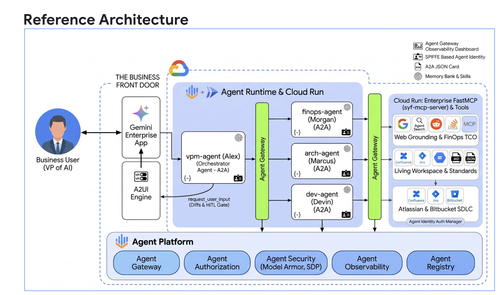

# `syf-mcp-server` — Enterprise SDLC FastMCP Server & Live Gateway Runtime

`syf-mcp-server` is the centralized **Model Context Protocol (FastMCP)** server, dynamic developer community intelligence hub, and live evaluation gateway web portal for the Virtual Product Manager platform (modeled for a large financial institution). Deployed on **Google Cloud Run**, it connects the ADK 2.0 agent fleet (`vpm-agent`, `finops-agent`, `arch-agent`, `dev-agent`) to **Google Cloud Storage (GCS)**, **Atlassian Confluence Cloud**, **Atlassian Jira Cloud**, and **Bitbucket Cloud** via **GCP Agent Identity Auth Manager** (`AuthProviderCredentialsServiceClient.retrieve_credentials`).



---

## 1. Live Endpoints Hosted on `syf-mcp-server`

- **MCP Streamable HTTP Endpoint**: `<SYF_PUBLIC_BASE_URL>/mcp`
- **Live Enterprise Skill Registry UI**: `<SYF_PUBLIC_BASE_URL>/skills-ui`
- **Live Envoy/OpenTelemetry DLP Gateway Dashboard**: `<SYF_PUBLIC_BASE_URL>/live-gateway`
- **Live Gateway Evaluation REST API**: `POST <SYF_PUBLIC_BASE_URL>/live-gateway/api/evaluate`
- **Health Check**: `<SYF_PUBLIC_BASE_URL>/healthz`

---

## 2. Exposed FastMCP Tools (`server.py`)

| # | MCP Tool Name | Description |
| :--- | :--- | :--- |
| 1 | `query_vendor_cost_benchmarks` | Computes deterministic 1-yr & 3-yr TCO across Arize AX, Braintrust, and Self-Hosted Langfuse v3 at `5M` and `50M` monthly spans (`seed_data/eval_vendor_benchmarks.json`). |
| 2 | `get_architecture_standards` | Retrieves enterprise CISO, OCC, PCI-DSS v4.0, CareCredit HIPAA, and ROSA Envoy mesh standards (`seed_data/architecture_standards.json`). |
| 3 | `list_workspace_documents` | Lists living workspace files (`PRD-AI-EVAL-101.md`, `ADR-001-Eval-Gateway.md`, `BACKLOG-AI-EVAL-101.json`) and their live Confluence/Jira/Bitbucket URLs. |
| 4 | `get_workspace_document` | Reads the full Markdown or JSON content of a living workspace file from GCS. |
| 5 | `save_workspace_document` | Overwrites a full workspace document in GCS and syncs to Confluence Cloud. |
| 6 | `patch_document_section` | Applies a surgical unified diff (`[-REMOVED-]` / `[+ADDED+]`) to a Markdown section and pushes a new Confluence Cloud version. |
| 7 | `create_jira_epic` | Updates Master Epic `SYF-5` and batch-creates 8 Sprint 1 stories (`SYF-6+`) in Jira Cloud upon Turn 2 HITL approval. |
| 8 | `create_jira_story` | Creates an individual Gherkin story under Master Epic `SYF-5` in Jira Cloud. |
| 9 | `publish_confluence_prd` | Promotes `PRD-AI-EVAL-101.md` and `ADR-001-Eval-Gateway.md` to `APPROVED` in Confluence Cloud Space `SD`. |
| 10 | `create_bitbucket_branch_and_pr` | Saves 8 scaffolded files to GCS (`scaffolded_code/*`), commits to Bitbucket Cloud (`syf-eval-gateway` branch `feature/SYF-5-envoy-otel-gateway`), opens a live PR, and transitions all 8 Sprint 1 Jira stories to **`DONE`**. |
| 11 | `sync_sdlc_ticket_blocker` | Records an engineering blocker in `BACKLOG-AI-EVAL-101.json` and patches `PRD-AI-EVAL-101.md`. |

---

## 3. Quick Setup, Deployment & Clean-Slate Reset

```bash
# 1. Enter syf-mcp-server and sync dependencies
cd syf-mcp-server
uv sync

# 2. Configure environment variables
cp .env.example .env
# Populate GOOGLE_CLOUD_PROJECT, SYF_WORKSPACE_BUCKET, ATLASSIAN_DOMAIN, ATLASSIAN_EMAIL, BITBUCKET_WORKSPACE, BITBUCKET_REPO_SLUG=syf-eval-gateway

# 3. Deploy to Google Cloud Run
gcloud run deploy syf-mcp-server \
  --source . \
  --project "$GOOGLE_CLOUD_PROJECT" \
  --region "$GOOGLE_CLOUD_REGION" \
  --allow-unauthenticated

# 4. Run 1-Command Clean-Slate Reset between demo runs
uv run python reset_demo_state.py
```
