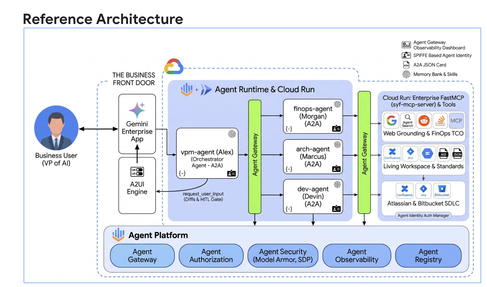

# `vpm-agent` — Alex (Root Virtual Product Manager Orchestrator)

**Alex (`vpm-agent`)** is the root orchestrator for the Synchrony Financial Virtual Product Manager platform. Built on **Google ADK 2.0 (`Workflow` Graph Orchestration, `@node`, `JoinNode`)** with **A2UI v0.9** interactive 3-card surfaces and deployed on **Vertex AI Agent Runtime (`ReasoningEngine`)**, Alex coordinates cross-functional product discovery, delegates financial and security audits in parallel to **Morgan (`finops-agent`)** and **Marcus (`arch-agent`)**, stages "Cursor-style" redline diffs on living Confluence & GCS specifications, enforces a Human-in-the-Loop (HITL) approval gate, and commits approved PRDs, ADRs, and 8 Sprint 1 Jira stories via `syf-mcp-server`.



---

## 1. Architecture & Runtime Profile

- **Framework**: Google ADK 2.0 (`google.adk.workflow.Workflow`, `JoinNode`, `@node(rerun_on_resume=True)`) + A2UI v0.9 (`app/ui_renderer.py`, `app/app_utils/a2ui_utils.py`)
- **Models**: `MODEL=gemini-3.8-flash` (orchestration) + `SPECIALIST_MODEL=gemini-3.5-flash-lite` (`GOOGLE_CLOUD_LOCATION=global`)
- **Deployment Target**: Vertex AI Agent Runtime (`deployment_target: agent_runtime`, `is_a2a: true`)
- **Memory**: **Vertex AI Memory Bank** (`app/memory_manager.py` — `before_agent_memory_bootstrap`, `after_agent_memory_commit`, `consolidate_executive_memory`)
- **Sub-Agent Handoffs**:
  - **`finops-agent` (Morgan)**: Invoked via Vertex AI Agent Runtime / A2A (`consult_morgan_finops_specialist`) for 1-year and 3-year vendor TCO modeling + live Google Search grounding.
  - **`arch-agent` (Marcus)**: Invoked over remote **A2A JSON-RPC** (`ARCH_AGENT_URL` — `consult_marcus_architecture_specialist`) for OCC, PCI-DSS v4.0, CareCredit HIPAA, and dynamic Executive Curveball (`CB-1`..`CB-5` + community intelligence) reviews.
  - **`dev-agent` (Devin)**: Previewed or invoked via `consult_devin_sdlc_specialist`.
- **MCP Integration**: Connects to `syf-mcp-server` (`/mcp`) using credentials resolved dynamically from **GCP Agent Identity Auth Manager** (`AuthProviderCredentialsServiceClient.retrieve_credentials`).

---

## 2. Core Tools (`app/tools.py`)

- **Specialist Delegation & Memory**:
  - `consult_morgan_finops_specialist`: Delegates 5M baseline & 50M surge TCO modeling to Morgan.
  - `consult_marcus_architecture_specialist`: Delegates zero-trust baseline audits & curveball blast-radius analysis to Marcus.
  - `consult_devin_sdlc_specialist`: Previews or delegates SDLC backlog & scaffolding actions to Devin.
  - `consolidate_executive_memory`: Commits approved FinOps, CISO, and SDLC decisions to Vertex AI Memory Bank.
  - `list_syf_skills` / `load_syf_skill`: Discovers and loads bundled `SKILL.md` playbooks.
- **FastMCP (`syf-mcp-server`) Tools (`ALEX_ALLOWED_MCP_TOOLS`)**:
  - `list_workspace_documents` / `get_workspace_document`: Reads living `PRD-AI-EVAL-101.md`, `ADR-001-Eval-Gateway.md`, and `BACKLOG-AI-EVAL-101.json` from GCS.
  - `patch_document_section`: Applies a surgical unified diff (`[-REMOVED-]` / `[+ADDED+]`) to a section of the PRD or ADR and updates Confluence Cloud (`DRAFT`).
  - `publish_confluence_prd`: Promotes `PRD-AI-EVAL-101.md` and `ADR-001-Eval-Gateway.md` to `APPROVED` in Confluence Cloud Space `SD`.
  - `create_jira_epic` / `create_jira_story`: Updates Master Epic `SYF-5` and batch-creates 8 linked Sprint 1 stories (`SYF-6+`) in Jira Cloud upon HITL sign-off.
  - `create_bitbucket_branch_and_pr` / `sync_sdlc_ticket_blocker`: Manages Bitbucket PR synchronization and engineering blocker updates.

---

## 3. Quick Setup, Testing & Deployment

```bash
# 1. From repository root, enter vpm-agent and install dependencies
cd vpm-agent
uv sync

# 2. Configure environment variables from template
cp .env.example .env
# Populate GOOGLE_CLOUD_PROJECT, SYF_WORKSPACE_BUCKET, SYF_MCP_URL, ARCH_AGENT_URL, FINOPS_AGENT_ENGINE_ID, etc.

# 3. Run unit & MCP integration tests
uv run pytest tests/unit -v

# 4. Launch local interactive ADK playground
uv run agents-cli playground

# 5. Deploy to Vertex AI Agent Runtime
uv run agents-cli deploy \
  --target agent-engine \
  --project "$GOOGLE_CLOUD_PROJECT" \
  --region "$GOOGLE_CLOUD_REGION"

# 6. Register Alex in Gemini Enterprise
VPM_ENGINE_ID="$(jq -r .remote_agent_runtime_id deployment_metadata.json)"
uv run agents-cli publish gemini \
  --project-id "$GOOGLE_CLOUD_PROJECT" \
  --app-id "$GEMINI_ENTERPRISE_APP_ID" \
  --location global \
  --agent-engine-id "$VPM_ENGINE_ID" \
  --display-name "Alex - Synchrony Virtual PM" \
  --description "Root Virtual Product Manager Orchestrator for Synchrony Financial"
```
